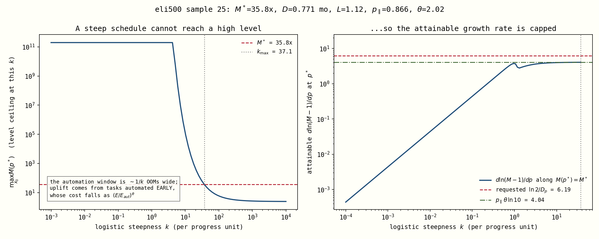
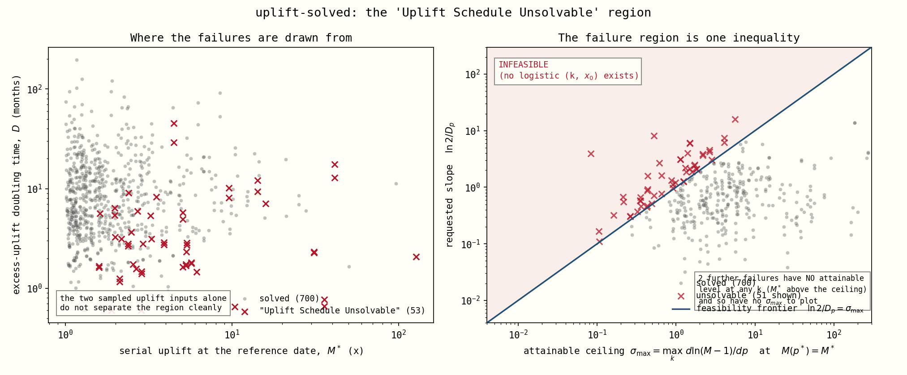

# Why some rollouts die with "Uplift Schedule Unsolvable"

*A plain-English companion to [`uplift_unsolvable_region.md`](uplift_unsolvable_region.md).
Same findings, no equations required.*

---

## What the model is being asked to do

In `uplift-solved` mode we don't tell the model when AI hits full coding automation.
Instead we tell it two things we think we know about **today**:

1. **The level** — "AI currently makes our coding researchers about **5× more
   productive**." (call it *M\**)
2. **The speed** — "and that boost is **doubling every 3 months**." (call it *D*)

The model then has to draw one S-curve — the schedule of how much of coding work gets
automated as compute grows — that passes through **both** of those hoops at once.

In 53 out of 754 rollouts (about 7%), it couldn't. Not because the solver gave up, but
because **no such S-curve exists**. Those runs are thrown away, and the run reports
"Uplift Schedule Unsolvable".

---

## The one-sentence answer

> **You can ask for a big productivity boost, or you can ask for a fast-growing one,
> but past a certain point you cannot have both — and where that point sits is set by
> two parameters nobody was looking at.**

---

## Why not? The intuition

Here's the thing that makes this non-obvious: **most of today's AI productivity boost
doesn't come from the tasks AI just learned to do. It comes from the tasks AI learned
to do a while ago.**

A task AI could already handle several doublings of compute ago is now dirt cheap to
run — you can throw enormous amounts of it at the problem. A task AI *just barely*
learned to do is still expensive. So the size of today's boost depends on how long
ago automation started, i.e. how **stretched out** the S-curve is.

That creates a trap:

| To get... | You need... | But that means... |
|---|---|---|
| A **big boost today** (high M\*) | a long history of cheap automation → a **stretched, gentle** S-curve | a gentle curve is, by definition, **growing slowly** |
| **Fast doubling** (small D) | a **steep** S-curve — lots of new automation right now | a steep curve has **no history** → today's boost is **small** |

Stretch the curve to get the level, and you lose the speed. Steepen it to get the
speed, and you lose the level. The two requests fight each other.

*Left: as the S-curve gets steeper (moving right), the biggest boost it can possibly
produce collapses — from 100 billion× down to about 6×. Right: the fastest growth it
can produce, given that it still has to hit the requested boost, flattens out at a
ceiling. The red dashed line is what this particular draw asked for. It's above the
ceiling, so there is nothing to find.*

---

## The speed limit

When you push the S-curve as steep as it will go while still delivering the requested
boost, everything automatable is already automated. At that point the *only* thing
still making AI researchers more productive is that **compute keeps getting more
efficient**. That's the hard ceiling, and it's beautifully simple:

> **Maximum growth rate = `parallel_penalty` × `compute-efficiency slope` × 2.303**

Two parameters. Not the automation asymptote, not the CES elasticity, not what
progress level you're at — those turn out to be **irrelevant** (their distributions in
the failed runs and the successful runs are literally identical).

Turned into something you can check by hand:

> ### **Fastest possible doubling ≈ 3.6 ÷ (`parallel_penalty` × `efficiency slope` × `progress rate`) months**
>
> (times a small correction that only matters when the boost is close to 1×)

Ask for anything faster and the rollout dies. **Every single time.** This one
inequality sorts all 754 rollouts perfectly:

*Left: the two things we actually sample — boost size and doubling time. The failures
(red) are scattered through the middle with no clean edge; you can't see the rule from
here. Right: the same runs, replotted against the speed limit. Everything above the
line fails, everything below it succeeds — with no overlap at all. The closest
survivor sits at 95% of its limit; the closest failure at 102%.*

---

## The exact version

The speed limit above isn't a fit or an approximation — once every task is
automatable, the model's uplift has a genuine closed form. The CES collapses to a
two-term expression whose only moving part is the AI's compute term, and everything
falls out of that.

**Elasticity of the uplift to effective compute**

$$\frac{d\ln M}{d\ln E} \;=\; p_\parallel\,\theta\,s$$

**Elasticity of the excess uplift** — the quantity the doubling time refers to

$$\frac{d\ln (M-1)}{d\ln E} \;=\; p_\parallel\,\theta\;\frac{M}{M-1}\;s$$

**where the distance-from-the-ceiling factor is**

$$s \;=\; 1-\left(\frac{M}{M_{\mathrm{cap}}}\right)^{-\rho/p_\parallel}\;\in\;(0,\,1)$$

**and the ceiling itself is**

$$M_{\mathrm{cap}} \;=\; \bar{Q}^{\,p_\parallel/\rho} \;=\; \varepsilon_{\mathrm{tail}}^{\,p_\parallel(1-\rho)/\rho}$$

Multiply by $\ln 10 \approx 2.303$ to get "per OOM of effective compute" instead of
"per log compute" — that's where the 2.303 in the speed limit came from.

### What all the letters mean

| symbol | in the code | what it is |
|---|---|---|
| $M$ | — | **the uplift.** How many times more coding labour the team effectively has, versus humans alone. $M=1$ means AI is contributing nothing. |
| $M-1$ | — | **the excess.** The part of the uplift that "doubles every D months" refers to. Doubling $M-1$ from 0.2 to 0.4 takes $M$ from 1.2× to 1.4×. |
| $E$ | — | **effective compute.** Progress $p$ is just $\log_{10}E$, so one progress unit = one OOM of effective compute. |
| $p_\parallel$ | `parallel_penalty` | **the parallelism haircut.** A big pile of AI labour run in parallel is worth less than the same labour run serially; the model raises labour to this power. Typically 0.1–0.9. |
| $\theta$ | `coding_automation_efficiency_slope` | **the compute-efficiency slope.** How fast AI's output per unit of compute improves as effective compute grows. Measured here in OOMs per *progress unit* (the sampled value is per progress-*year*, so divide by the anchor rate). |
| $\rho$ | `rho_coding_labor` | **the CES substitution parameter.** Negative means AI and humans are *complements* — you can't fix a missing human step by throwing more AI at it. Typically −1 to −5. |
| $M_{\mathrm{cap}}$ | ≈ `max_serial_coding_labor_multiplier` | **the hard ceiling on the uplift.** No schedule and no amount of compute gets $M$ above this. |
| $\varepsilon_{\mathrm{tail}}$ | `tail_eps` (derived) | **the un-automatable sliver.** The fraction of tasks at the very top of the difficulty grid that the frontier never automates. It's what creates the ceiling. |
| $s$ | — | **the throttle.** See below. Between 0 and 1. |

### So what is $s$?

$s$ is the fraction of each compute-efficiency gain that actually turns into uplift
growth. Formally it's the AI term's share of the CES labour aggregate,
$s = x/(1+x)$ where $x$ is the ratio of the AI-compute term to the leftover
human-bottleneck term. Informally:

- **$s \approx 1$ — AI is the binding input.** There's still plenty of headroom below
  the ceiling, so every bit of extra compute efficiency shows up one-for-one in the
  uplift. Growth runs at its full rate $p_\parallel\theta$.
- **$s \approx 0$ — the un-automatable sliver is the binding input.** You've squeezed
  out everything automation can give. Extra compute now does essentially nothing,
  because the work that's left isn't compute-limited. Growth stalls at the ceiling.

So $s$ is a diminishing-returns dial that starts wide open and closes as $M$ climbs
toward $M_{\mathrm{cap}}$ — which is exactly what the middle expression says:
$s = 1 - (M/M_{\mathrm{cap}})^{-\rho/p_\parallel}$.

And notice what is *not* anywhere in these formulas: the automation asymptote, the
shape of the S-curve, where you are in progress. Given the parameters, the growth rate
depends on the current uplift **and nothing else**.

One more thing worth staring at: $M_{\mathrm{cap}}$ turns out to be exactly the
`max_serial_coding_labor_multiplier` parameter (whenever the tail isn't clipped by its
own bounds). The ceiling wasn't an emergent mystery — it was an input all along.

### Excess vs raw: they behave quite differently

The doubling time in the elicitation is about the **excess**, $M-1$, so that second
formula is the one that governs feasibility. It is not a cosmetic rewrite of the first:

- **The raw uplift has a plateau; the excess doesn't.** $d\ln M/d\ln E$ climbs to
  exactly $p_\parallel\theta$ and sits there for many OOMs. The excess is always
  *above* that, by the factor $M/(M-1)$, and only settles onto it from above once
  $M \gg 1$.
- **The excess elasticity only ever falls.** Along any trajectory both of its moving
  parts shrink — $M/(M-1)$ as the uplift grows, and $s$ as it nears the ceiling — so
  the product is strictly decreasing. **The excess-uplift doubling time can only get
  longer**, and its fastest value is at the moment full automatability is reached.
  That's precisely why the feasibility ceiling gets evaluated there.
- **It blows up as $M \to 1$.** At a 1.01× uplift the excess grows 101× faster than
  the uplift itself. That is the whole reason small-boost draws never fail: they have
  about four orders of magnitude of slope headroom.

Worked through for `eli500#27` ($p_\parallel\theta\ln 10 = 0.593$ per OOM):

| uplift $M$ | $d\ln M/d\ln E$ | $d\ln(M-1)/d\ln E$ | $s$ | excess doubles every |
|---|---|---|---|---|
| 2.1× | 0.214 | 0.402 | 1.000 | 0.75 OOMs |
| 28.8× | 0.258 | 0.267 | 1.000 | 1.13 OOMs |
| 4.1e6× | 0.258 | 0.258 | 1.000 | 1.17 OOMs |
| 6.9e7× | 0.120 | 0.120 | 0.467 | 2.50 OOMs |
| 7.7e7× (= cap) | 0 | 0 | 0 | never |

### Three regimes

| where you are | what happens |
|---|---|
| **Far below the ceiling** (*s* ≈ 1) | Growth is **exactly `p∥ × θ`** per log-compute. This *is* the speed limit. |
| **Approaching the ceiling** | The gap closes as a power law, *M*cap − *M* ∝ *E*ρθ, and growth decays to zero. You have about log₁₀(*M*cap/*M*) ÷ (`p∥`·θ) OOMs of runway before this bites. |
| **Uplift near 1×** | The *M*/(*M*−1) factor blows up: the *excess* can double arbitrarily fast even while the boost itself barely moves. This is why small-boost draws had ~4 orders of magnitude of headroom and never failed. |

### It checks out

Against the actual model code, across seven orders of magnitude of *M*/*M*cap:

| draw | *M* | *M*/*M*cap | model | closed form | rel. error |
|---|---|---|---|---|---|
| eli500 #27 | 171 | 2e−6 | 0.596449 | 0.5964606 | 2e−5 |
| eli500 #27 | 4.07e6 | 0.053 | 0.5929658 | 0.5929658 | **8e−13** |
| eli500 #3 | 9 740 | 0.011 | 1.077784 | 1.077784 | 2e−10 |
| eli500 #3 | 889 426 | 0.997 | 0.005953199 | 0.005953195 | 6e−7 |
| eli500 #480 | 2.4185 | 0.9991 | 0.003480029 | 0.003480026 | 9e−7 |

And the ceiling formula reproduces the level ceiling I originally had to find by brute
force **to machine precision** — max relative error 4×10⁻¹⁵ across 80 draws.

### Which means the two failure modes are one formula

Everything in this document is now the same inequality read two ways:

- **51 runs** asked for growth above `p∥ · θ · ln10 · M/(M−1)` — the *s* ≈ 1 ceiling.
- **2 runs** asked for a boost above *M*cap — the ceiling itself.

---

## Is it a bug?

**No.** This was the main thing to rule out, and it's ruled out three ways:

- We mapped the error surface on a dense grid across every possible S-curve shape for
  the failing cases. There's no solution hiding anywhere — for one case, every shape
  that gets the *level* right has the *speed* stuck 78% too low.
- We re-ran the boundary calculation at 10× finer resolution on the 18 closest calls.
  Nothing moved (< 0.005%) and nothing flipped.
- We varied the numerical step size by 100×. Identical answers.

So: **51 of the 53 are genuine "no such curve exists". Zero are the solver fumbling a
solvable problem.**

### The other 2

Two failures (the same random draw appearing in both runs — same seed) are a different
and much dumber problem: that draw asks for a **41× productivity boost** while a
*separate* parameter in the same draw, `max_serial_coding_labor_multiplier`, caps the
boost at **1.37×**. Two parameters describing the same quantity, sampled independently,
30× apart. Worth fixing at the sampling layer.

---

## Why this matters beyond the error message

**The 7% we lose is not a random 7%.**

The runs that die are the ones with a big AI boost, growing fast, in worlds where
compute efficiency improves slowly. That is precisely the **fast-takeoff tail**.
Silently deleting it tilts the whole forecast toward slower takeoff.

So this isn't just noise in the pipeline — it's a systematic thumb on the scale, and
it should be handled deliberately rather than by rollouts quietly failing.

---

## What to do about it

1. **Stop sampling the doubling time independently.** How fast the boost can double is
   physically tied to `parallel_penalty` and the compute-efficiency slope. Sample "how
   close to the physical floor" instead of an absolute number of months, or correlate
   them in `input_distributions.yaml`.
2. **Reject at sample time, with the formula above.** Then the hole in the posterior is
   explicit and countable instead of being 7% of rollouts that vanish.
3. **Make `max_serial_coding_labor_multiplier` consistent with the requested boost.**
4. **Make the error message say why.** Right now the failure carries no diagnostics —
   the code computes the reachable range, logs it, and the batch workers throw the log
   away. Attaching it to the exception (the way the three-condition path already does)
   would have turned this whole investigation into a one-line search.

---

*Technical version, with the derivation, the exact numbers, and the reproduction
recipe: [`uplift_unsolvable_region.md`](uplift_unsolvable_region.md).*
