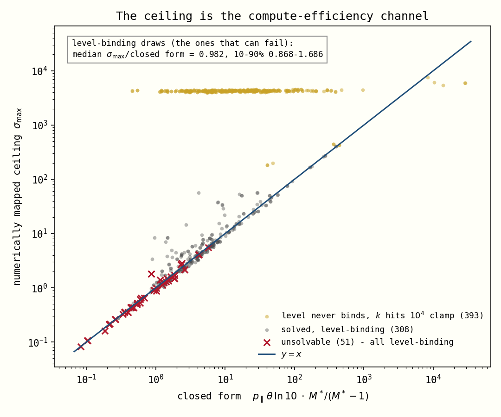

# The "Uplift Schedule Unsolvable" region in `ac_anchor_mode='uplift-solved'`

*Analysis of the 53 solver failures in `/root/uplift_eli_500/20260807_172703` (36 of
500) and `/root/diag_5050_v2/20260807_032429` (17 of 254 uplift-mode rollouts).*

## Verdict in one paragraph

Every one of the 53 failures is a **true infeasibility**, not a solver miss. 51 of
them fail the *slope* condition: the requested excess-uplift doubling is faster than
**any** logistic automation schedule can produce at the requested uplift level. The
remaining 2 fail the *level* condition: the requested uplift exceeds what the model
can produce at that reference progress under **any** schedule, because the same draw
also sampled a low `max_serial_coding_labor_multiplier`. Zero failures are cases where
a solution exists and the Newton → bracketed-1-D → `least_squares` ladder failed to
find it. The attainable slope ceiling has a closed form:

$$\sigma_{\max}\;\approx\;p_{\parallel}\;\theta\;\ln 10\;\cdot\;\frac{M^*}{M^*-1}$$

with $p_\parallel$ = `parallel_penalty` and $\theta$ =
`coding_automation_efficiency_slope` **in OOMs per progress unit** (the sampled
OOMs/progress-year value divided by the present-day anchor rate). A draw is feasible
iff $\ln 2 / D_p < \sigma_{\max}$, where $D_p$ is the excess-doubling time converted
to progress units at the reference date's own rate.


Left: the failures in the two sampled uplift inputs — a diffuse "high $M^*$, short $D$"
cloud with no clean edge. Right: the same 753 draws plotted against the numerically
mapped ceiling. The separation is exact — the largest ratio among the 700 solved draws
is **0.951**, the smallest among the 51 slope-infeasible failures is **1.020**.

## 1. Empirics

Parameter distributions (10th / 50th / 90th percentile), pooled over both runs, for
the 53 solver failures vs the 700 solved uplift-mode draws:

| quantity | failures | solved | discriminates? |
|---|---|---|---|
| $M^*$ `serial_uplift_at_reference_date` | 1.98 / **3.91** / 31.1 | 1.08 / **1.55** / 4.80 | weakly |
| $D$ `excess_uplift_doubling_time` (months) | 0.85 / **2.74** / 10.0 | 2.53 / **7.79** / 26.1 | weakly |
| $D_p$ (progress units, at the reference rate) | 0.12 / 0.52 / 2.23 | 0.32 / 1.13 / 4.04 | weakly |
| $\theta$ (OOMs per **progress unit**) | 0.21 / **0.58** / 1.92 | 0.58 / **1.91** / 11.5 | strongly |
| $\theta$ (as sampled, per progress-**year**) | 0.52 / 0.95 / 2.42 | 1.12 / 2.94 / 8.81 | strongly |
| $p_\parallel$ `parallel_penalty` | 0.25 / 0.43 / 0.71 | 0.25 / 0.49 / 0.74 | barely |
| $p_\parallel\cdot\theta$ | 0.085 / **0.22** / 0.68 | 0.30 / **1.00** / 4.17 | strongly |
| $L$ `automation_logistic_asymptote` | 1.01 / 1.12 / 10.5 | 1.01 / 1.12 / 2.81 | **no** |
| $\rho$ `rho_coding_labor` | −5 / −2 / −1 | −5 / −2 / −1 | **no** |
| $p^*$ reference progress | 30.8 / 35.9 / 61.1 | 30.6 / 35.7 / 48.9 | **no** |

The boundary is **not** a surface in $(M^*, D, L, \rho, p_\parallel)$: $L$ and $\rho$
carry essentially no signal, and the variable that matters most, $\theta$, was not on
the original suspect list. The boundary *is* a smooth surface — a single hyperplane,
in fact, in the coordinates $\big(\ln 2/D_p,\ p_\parallel\theta\ln 10\cdot
M^*/(M^*-1)\big)$.

Numerically mapped ceiling vs the closed form:



On the 359 draws where the level constraint actually binds, median
$\sigma_{\max}$/closed form = **0.982** (10–90%: 0.868–1.686); restricted to the 51
failures, **0.967** (5–95%: 0.832–1.204). The horizontal band at $\sigma_{\max}\approx
4\times10^3$ is the other regime: 393 low-$M^*$ draws where the level condition never
binds and the ceiling is instead set by the solver's own `UPLIFT_SOLVE_K_MAX = 1e4`
clamp. No failure lives there — those draws have four orders of magnitude of headroom.

## 2. Mechanism: why no schedule exists

`serial_uplift_for_logistic` evaluates $M(p)$ through the **optimal-CES frontier**, so
$M(p^*)$ depends on the whole schedule below $p^*$, not just on $A(p^*)$. Two facts
(both verified numerically over the failing draws) pin the problem down.

**(a) At fixed $k$, $M(p^*)$ is monotone increasing in $a=A(p^*)$.** Checked on a
300-point grid in $a$ at $k\in\{0.01,1,10,100\}$ for four representative failures — no
violations. So the level condition $M(p^*)=M^*$ maps $x_0 \leftrightarrow a$
one-to-one, and the reachable level interval at a given $k$ is $[1,\ M(p^*;k,a{=}L^-)]$.

**(b) That upper end is steeply *decreasing* in $k$.** This is the crux. Task $i$'s
automation threshold is $\pi(i)=x_0-\ln(L/i-1)/k$, so the whole automation window is
$\sim\Lambda/k$ OOMs wide (with $\Lambda=\ln(L/\texttt{AUTOMATION\_FRACTION\_CLIP\_MIN})
\approx 21$). Uplift comes overwhelmingly from tasks automated **early**: their
compute cost enters the frontier as $(E/E_{\text{aut}})^{\theta}$, an efficiency bonus
that grows exponentially in how far below $p^*$ the task was automated. A steep
schedule packs every threshold into a narrow band just below $p^*$, destroying the
bonus. For `eli500#25` the level ceiling falls from $2\times10^{11}$ at $k\lesssim 3$
to 5.9× at $k=100$.


Put together, the level condition caps the steepness at some
$k_{\max}(M^*)$ — and the slope condition wants steepness. Along the
$M(p^*)=M^*$ manifold the attainable $d\ln(M-1)/dp$ rises with $k$ and saturates as
$k \to k_{\max}$, where $A(p^*)$ has been pushed to the asymptote and further growth
of $M$ can come only from the **compute-efficiency channel**. There, all automatable
tasks are already automated and the optimal-CES labour is driven by
$S = \kappa\,\eta\,E^{\theta}$, so $d\ln L_{\text{opt}}/dp = \theta\ln 10$; the
parallel penalty ($L_{\text{ai}} = L_{\text{opt}}^{p_\parallel}$) scales that to
$d\ln M/dp = p_\parallel\theta\ln 10$, and converting from $M$ to the excess $M-1$
multiplies by $M/(M-1)$. That is exactly the closed form above, and it is why the
ceiling is independent of $L$, of $\rho$, and of $p^*$.

### The exact elasticity (and why the level ceiling is closed-form too)

The sketch above can be made exact. Once every task is automatable, $\bar\imath$ stops
moving, the frontier's $\bar Q = (1-\bar\imath)^{1-\rho}$ and $\bar B = B(\bar\imath)$
freeze, and `coding_labor_optimal_ces` reduces to its boundary branch:

$$(L_{\text{opt}}/H)^{\rho}=\bar Q+S^{\rho}\bar B^{\,1-\rho},\qquad
S=\tfrac{C}{H}\,\eta\,E^{\theta},\qquad M=(L_{\text{opt}}/H)^{p_\parallel}$$

(the last equality is exact because the human-only baseline is $H^{p_\parallel}N$ and
the same normalisation $N$ cancels). Writing $x = S^{\rho}\bar B^{1-\rho}/\bar Q$ gives
$M = M_{\text{cap}}(1+x)^{p_\parallel/\rho}$ with $d\ln x/d\ln E = \rho\theta$, so the
$\rho$'s cancel:

$$\boxed{\;\frac{d\ln M}{d\ln E}=p_\parallel\theta\,s,\qquad
\frac{d\ln (M-1)}{d\ln E}=p_\parallel\theta\,\frac{M}{M-1}\,s,\qquad
s=\frac{x}{1+x}=1-\Big(\frac{M}{M_{\text{cap}}}\Big)^{-\rho/p_\parallel}\;}$$

$$M_{\text{cap}}=\bar Q^{\,p_\parallel/\rho}
=\texttt{tail\_eps}^{\,p_\parallel(1-\rho)/\rho}
=\texttt{max\_serial\_coding\_labor\_multiplier}$$

(multiply by $\ln 10$ for per-progress-unit; the last identity holds whenever
`tail_eps` is not clipped by `PARAMETER_BOUNDS`). Given the parameters this is a
function of the **current uplift alone** — no $k$, no $x_0$, no $L$, no $p^*$.

Three regimes, and both failure modes fall out of the same expression:

| regime | elasticity | relevance |
|---|---|---|
| $M \ll M_{\text{cap}}$, $s\to1$ | exactly $p_\parallel\theta$ | this **is** $\sigma_{\max}$; the 51 slope failures |
| $M \to M_{\text{cap}}$ | decays; $M_{\text{cap}}-M \propto E^{\rho\theta}$ | runway is $\log_{10}(M_{\text{cap}}/M)/(p_\parallel\theta)$ OOMs |
| $M \to 1$ | $M/(M-1)$ diverges | why low-$M^*$ draws have ~4 OOMs of headroom |

Verified against `serial_uplift_for_logistic` over seven orders of magnitude of
$M/M_{\text{cap}}$ — machine-exact in the boundary branch, ~$10^{-4}$ in the interior
branch a couple of OOMs past the transition:

| draw | branch | $M$ | $M/M_{\text{cap}}$ | model $d\ln(M-1)/dp$ | closed form | rel |
|---|---|---|---|---|---|---|
| `eli500#27` | interior | 171 | 2e−6 | 0.596449 | 0.5964606 | 2e−5 |
| `eli500#27` | boundary | 4.07e6 | 0.053 | 0.5929658 | 0.5929658 | **8e−13** |
| `eli500#3` | boundary | 9740 | 0.011 | 1.077784 | 1.077784 | 2e−10 |
| `eli500#3` | boundary | 889426 | 0.997 | 0.005953199 | 0.005953195 | 6e−7 |
| `eli500#480` | boundary | 2.4185 | 0.9991 | 0.003480029 | 0.003480026 | 9e−7 |

And $M_{\text{cap}}=\bar Q^{p_\parallel/\rho}$ reproduces the level ceiling that §2's
brute-force scan measured, to **machine precision** (max relative error
$4\times10^{-15}$ across 80 draws) — so the "level-unreachable" test is simply
$M^* > M_{\text{cap}}$, no scan required. Reproduce with
`scripts/scratch/uplift_unsolvable_elasticity.py`.

**Not** the cause, checked explicitly:

- *Numerical overflow / underflow masquerading as infeasibility.* The frontier is
  computed in log space and the failure boundary is unchanged when the finite-difference
  step is varied over $10^{-2}, 10^{-3}, 10^{-4}$ (ratios agree to 4 decimals).
- *Grid resolution in the frontier map.* Re-mapping the 18 closest-to-boundary failures
  with a 10× finer scan (1600 rungs in $k$ instead of 160) moves $\sigma_{\max}$ by
  <0.005% and flips nothing.
- *Solver misses.* A dense $|r|_\infty$ field over $(\ln k, x_0)$ (90×90, spanning
  $k\in[10^{-4},10^4]$ and $x_0\in p^*\pm 40$) has no zero for the failures examined:
  for `eli500#27` every cell with $|r_1|<0.05$ (level satisfied) has $r_2 \approx
  -0.78$ — the slope is stuck 78% below target. And the population test is decisive:
  **all 51** slope-failures have target/$\sigma_{\max}>1$ and **all 700** solved draws
  have it $<1$.

### The two level-unreachable failures

`eli500#480` and `diag5050#480` (the same draw — both runs used seed 42) ask for
$M^*=41.2\times$ while the achievable maximum over the *entire* $(k,x_0)$ plane is
**2.42×**, flat in $k$ down to $k=10^{-12}$ (so not a clamp artifact) — and equal, to
15 digits, to the closed-form $M_{\text{cap}} = \bar Q^{\,p_\parallel/\rho}$ derived
above. The reason is a different sampled parameter:
`max_serial_coding_labor_multiplier` was drawn at **1.37×**, and it *is* that ceiling
(here it reads 2.42 rather than 1.37 only because the derived `tail_eps` hit its
`PARAMETER_BOUNDS` clip at 0.1). Across all draws,
$\mathrm{corr}(\ln \text{level ceiling}, \ln \text{cap}) = 0.889$, and the two agree
exactly on the 23/80 spot-checked draws where no clipping intervenes. This is a
**sampling-level contradiction** — two independently drawn parameters describing the
same quantity, one 30× the other.

## 3. Cause split

| run | uplift-mode draws | solver failures | slope-infeasible | level-unreachable | solver miss |
|---|---|---|---|---|---|
| `uplift_eli_500/20260807_172703` | 500 | 36 (7.2%) | 35 (97%) | 1 (3%) | 0 |
| `diag_5050_v2/20260807_032429` | 254 | 17 (6.7%) | 16 (94%) | 1 (6%) | 0 |
| **total** | 754 | 53 | **51** | **2** | **0** |

(`eli500` had one additional failure, a 5-second rollout timeout, unrelated to the
anchor solve.)

## 4. What a forecaster should do

**The rule.** A draw is representable iff its excess-uplift doubling time exceeds

$$D_{\min}\ [\text{months}]\;\approx\;\frac{12\ln 2}{\ln 10}\cdot\frac{1-1/M^*}{p_\parallel\,\theta\,\hat r}\;=\;\frac{3.61\,\big(1-1/M^*\big)}{p_\parallel\;\theta\;\hat r}$$

where $\theta$ is in OOMs per progress unit and $\hat r$ is the progress rate at the
reference date (progress units per year; median 1.6, 10–90% 0.94–3.2 in these runs).
Applied as a screen this rule misclassifies 19/754 draws (2.5%) — all near the
boundary, where the closed form's ±20% error dominates; the exact frontier
(`slope_frontier` in the scratch script) separates 754/754.

**In words.** *The serial coding uplift cannot double its excess faster than the
underlying compute-efficiency channel allows, because the only way to make it grow
faster is to steepen the automation schedule — and steepening the schedule destroys
the accumulated cheap-early-automation that produced the uplift level in the first
place.* The binding rate is
$p_\parallel \times \theta \times \ln 10$ per OOM of effective compute. With Eli's Q2
draws the median floor is $D_{\min}\approx 0.8$ months, but the 10th percentile draw
of $p_\parallel\theta$ pushes it to ~3.4 months, and 8.2% of $D$ draws land below
their own floor.

**Practical fixes, in preference order:**

1. **Correlate the sampling.** $D$ should not be drawn independently of
   $p_\parallel$ and $\theta$. Either sample $D/D_{\min}$ (a dimensionless "how close
   to the physical floor" quantity) or impose the correlation in
   `input_distributions.yaml`.
2. **Reject/clip at sample time** with the closed form above, so the rejection is
   explicit and auditable rather than a 7% silent hole in the posterior.
3. **Fix the level contradiction**: enforce
   $M^* \le$ `max_serial_coding_labor_multiplier` when sampling.

**This matters for the posterior.** The failures are not missing at random: they
delete the high-uplift / fast-doubling / low-$\theta$ corner, which is exactly the
fast-takeoff tail. A 7% loss concentrated there biases results toward slower takeoff.

## 5. Solver observations (none of them cause these failures)

1. **The exception carries no reachable range.** `_solve_uplift_anchored_automation_model`'s
   two-condition branch raises `ValueError(... See the preceding warning for the
   reachable range.)`, but the warning goes to a logger that batch workers suppress —
   so `rollouts.jsonl` records the failure with no diagnostics. The three-condition
   branch already threads a `failure_info` dict into its message; the two-condition
   branch should do the same (attach $\sigma_{\max}$ / the minimum feasible $D$).
   This is the single highest-value fix: it would have made this whole investigation
   a one-line grep.
2. **The bracketed seed's monotonicity claim is stronger than the truth.**
   `_bracketed_seed_logistic_from_uplift`'s docstring states the achieved slope
   "increases monotonically in $k$". It usually does, but not always: for `eli500#27`
   the slope peaks at $k\approx 6.6\times10^{-4}$, dips ~3%, then flats out. The
   25-rung ladder takes the first sign change, so a target lying only inside a narrow
   non-monotone bump between rungs would be reported as unreachable. It never happened
   in these 754 draws, but the invariant should be softened in the comment (or the
   ladder densified near the maximum).
3. **`UPLIFT_SOLVE_K_MAX = 1e4` is the operative ceiling for 393/752 draws.** For
   low $M^*$ the level condition never binds and $\sigma_{\max}$ is set purely by that
   clamp — i.e. the "reachable slope range" the solver would report in that regime is
   an artifact of a constant, not of model physics. Harmless today (those draws have
   ~4 OOMs of headroom) but worth knowing before anyone quotes the range to a user.
4. **`AUTOMATION_FRACTION_CLIP_MIN = 1e-9` sets the automation-window width**
   $\Lambda = \ln(L/10^{-9}) \approx 21$ OOMs, and hence $k_{\max}$ at a given $M^*$.
   The *level* ceiling curve therefore inherits a dependence on an arbitrary numerical
   floor. The *slope* ceiling — the thing that actually causes the failures — does not.

## Reproduction

```bash
# 1. stream the two runs' rollouts.jsonl on the runpod and pull the parameter dumps
#    (runs on the runpod; streams line-by-line, never loads the 130 MB files whole)
python3.13 uplift_unsolvable_extract.py --stream /root/uplift_failures_full.json \
    eli500=/root/uplift_eli_500/20260807_172703/rollouts.jsonl \
    diag5050=/root/diag_5050_v2/20260807_032429/rollouts.jsonl
scp aifm-runpod:/root/uplift_failures_full.json /tmp/
python scripts/scratch/uplift_unsolvable_extract.py /tmp/uplift_failures_full.json   # tidy table + summary

# 2. re-run every draw to the anchor solve, map the feasibility frontier (~15 min, 16 procs)
UPLIFT_WORKERS=16 python scripts/scratch/uplift_unsolvable_scan.py

# 3. figures
python scripts/scratch/uplift_unsolvable_plot.py
```

`scripts/scratch/uplift_unsolvable_probe.py` holds the instrumentation:
`capture_solver_args` (runs `ProgressModel` until `solve_logistic_from_uplift` and
captures its exact arguments — verified against the recorded error strings to 6
significant figures), `slope_frontier` (the exact numeric feasibility frontier),
`residual_field` (the dense $(\ln k, x_0)$ residual map), `slope_ladder` (a replica of
the production bracketed seed's ladder).

*Caveat:* both runs predate the `parameters.py` guard that rejects setting
`swe_multiplier_at_present_day` and `serial_uplift_at_reference_date` together, so
reproduction drops the former (which uplift-solved mode ignores anyway). The captured
$(M^*, p^*, D_p, L)$ match the recorded error messages exactly, which validates the
substitution.
